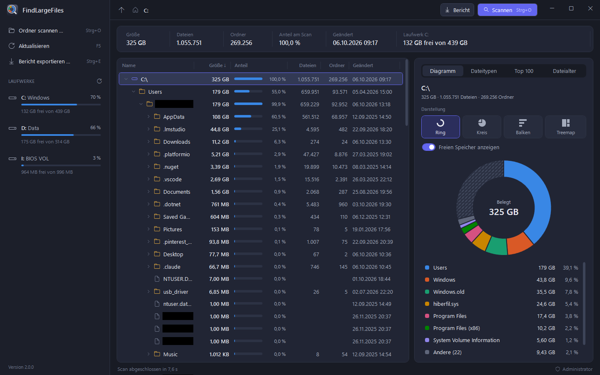

# FindLargeFiles

**FindLargeFiles** finds out what is using your storage – starting from a drive or any folder.
The results are shown as a sorted tree and as a chart.



## Download

Get the latest version from **[Releases](../../releases/latest)** – just download `FindLargeFiles-<version>-win-x64.exe`
and run it. It is a single file with no installation; no .NET runtime is required (Windows 10/11, x64).

Every push to `main` automatically builds a new release via [GitHub Actions](.github/workflows/release.yml):
it runs the tests, publishes a self-contained executable and attaches a ZIP and SHA-256 checksums. The version number
combines `<Version>` in [`FindLargeFiles.csproj`](src/FindLargeFiles/FindLargeFiles.csproj) (major and minor version) with the
workflow run number, e.g. `v2.0.17`.

## Features

- **Drive overview** – all drives with usage, free space and a color-coded fill gauge; one click starts the scan.
- **Fast parallel scan** – a worker pool reads the directory tree (over a million files in seconds), with live progress and cancellation (`Esc`).
- **Tree view** – size, share of the parent folder, number of files/folders and modification date; sortable by column header, virtualized, large folders are loaded in pages.
- **Charts** – donut, pie, bar and treemap for the selected folder, including “free space” at the drive root. Clicking a segment opens the folder.
- **File types** – storage usage by file extension.
- **Top 100 files** – the largest files below the selection.
- **File age** – storage by last modification (< 1 month … > 5 years).
- **Reports & export** – detailed storage reports for the selected folder or the entire scan:
  - **Excel (.xlsx)** – one sheet per section, sizes as real byte values displayed as KB/MB/GB, folder structure as a collapsible outline, filters and data bars.
  - **PDF** – print-ready A4 report with key figures, donut chart and tables.
  - **CSV** – semicolon-separated (UTF-8), one file per section.
  - **HTML** – a single file without external dependencies, with light/dark mode, chart, collapsible tree and sortable tables.
  - Selectable content: folder structure (1–5 levels, optionally with files), largest files (25/100/500), file types, file age.
- **Actions** – open, show in Explorer, copy path, scan this folder only, refresh folder, move to Recycle Bin, properties.
- **Restart as administrator** – to also read protected system folders.

## Languages

FindLargeFiles is translated into **English, German, French, Spanish, Portuguese, Italian and Hindi**.
On startup it uses the Windows display language; if there is no translation for it, the app is shown in English
and displays a one-time hint on how to translate it yourself (remembered under `HKCU\Software\FindLargeFiles\Localization`).
Number and date formats always follow the Windows regional settings.

- **Translation files** are JSON files in [`src/FindLargeFiles.Core/Localization`](src/FindLargeFiles.Core/Localization),
  named after the ISO code of the language (`en.json`, `de.json`, …). Regional variants such as `pt-BR.json` are also
  supported and override the general language.
- **Your own translations** are loaded from `%LOCALAPPDATA%\FindLargeFiles\Localization` (or a `Localization` folder next to the
  executable) and take precedence over the built-in ones. Missing keys fall back to English.
- **Keys** follow the [Lokalise recommendations](https://lokalise.com/blog/translation-keys-naming-and-organizing/):
  `area.element` in `snake_case`, at most three levels, shared texts under `global`, complete sentences with named
  placeholders (`{count}`) instead of concatenated fragments, plurals via `_one`/`_other`.
- **Force a language** (e.g. for testing): create a string value `Language` with the value `fr` under
  `HKCU\Software\FindLargeFiles\Localization`.

Tests verify that every language has exactly the same keys and placeholders as English.

## Keyboard

| Key | Action |
|---|---|
| `Ctrl+O` | Scan folder |
| `Ctrl+E` | Export report |
| `F5` | Refresh the selected folder |
| `Esc` | Cancel scan |
| `→` / `←` | Expand/collapse folder |
| `Backspace` | Go to parent folder |
| `Enter` | Open |
| `Del` | Move to Recycle Bin |

## Structure

| Project | Contents |
|---|---|
| `src/FindLargeFiles.Core` | Scanner, data model (`FsNode`), analyses and translations – no UI dependencies |
| `src/FindLargeFiles.Reporting` | Report model and writers for Excel (ClosedXML), PDF (QuestPDF), CSV and HTML |
| `src/FindLargeFiles` | WPF user interface (.NET 10, CommunityToolkit.Mvvm), custom dark theme and chart control |
| `tests/FindLargeFiles.Core.Tests` | xUnit tests for the scanner, analyses, translations and all export formats |

## Building

```powershell
dotnet build
dotnet test
dotnet publish src/FindLargeFiles -c Release   # self-contained single-file executable (win-x64)
```

A folder can be passed as a start argument and is scanned immediately: `FindLargeFiles.exe "D:\Data"`.

## License

FindLargeFiles is licensed under the **[PolyForm Noncommercial License 1.0.0](LICENSE.md)**.

- **Permitted (free of charge):** personal use – e.g. on your own computers, for hobby projects, learning and research –
  as well as use by charitable organizations, educational and research institutions and government agencies.
  Sharing and modifying the software is also permitted for these purposes, as long as the license and the copyright notice are included.
- **Not permitted without my consent:** any commercial use – for example use within companies, as part of a
  paid product or service, or selling the software or modified versions of it.

Commercial use requires a separate license. Please send requests via an
[issue](../../issues/new) in this repository.

## Third-party licenses

- [CommunityToolkit.Mvvm](https://github.com/CommunityToolkit/dotnet) – MIT
- [ClosedXML](https://github.com/ClosedXML/ClosedXML) – MIT
- [QuestPDF](https://www.questpdf.com/license/) – Community License (free, among others, for open-source projects and companies with less than USD 1M annual revenue)

## Note

Sizes are logical file sizes. Hard links (e.g. in `C:\Windows\WinSxS`) are counted multiple times, so the total for a system drive can be higher than the space actually used.
